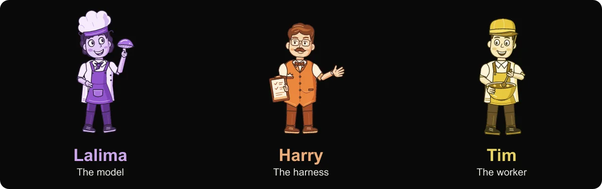

<div align="center">

## Agentic AI workshop 2026

**NYU Center for Data Science · October 8–29, 2026**<br>
With [Adi Singhal](https://www.linkedin.com/in/adi-singhal/) and [Luca Chang](https://www.linkedin.com/in/luca-chang/)

[2026 class website](https://adityasinghal.com/agentic-ai-workshop-2026/) · [Class app portal](https://nyu-workshop.adityasinghal.com/) · [Workshop feedback](https://forms.gle/ce6MF1g3DAKRyoWh7)



Build an agent around an idea you care about, then inspect how it works.

[Course materials](#course-materials) · [Run your first app](#run-your-first-app) · [Publish your app](#make-it-yours-and-publish) · [Get help](#schedule-and-help)

</div>

> [!TIP]
> New to agents? Start with [Dinner for two](session-01-agent-harnesses/readings/dinner-for-two-2026-10-07.md), then try the small Python app below. For a free scripted preview, follow the [HN harness guide](session-01-agent-harnesses/demo-app/README.md) and run `npm run dev:fixture`.

<details>
<summary><strong>Meet Lalima, Harry and Tim</strong></summary>

The restaurant story separates three jobs:

| Character | Role | In an agent application |
| --- | --- | --- |
| Lalima | The model | Interprets the request and proposes what to do next. |
| Harry | The harness | Supplies context, runs the loop, checks permissions and keeps records. |
| Tim | The worker | Executes tool code and returns observations. |

Follow the [full story](session-01-agent-harnesses/readings/dinner-for-two-2026-10-07.md), or watch the [Session 1 explanation at 23:28](https://www.youtube.com/watch?v=UtjOl-LPcCk&t=1408s).

</details>

### Course materials

All three teaching sessions have released slides and runnable examples.
Download each HTML slide deck and open it in a browser; **N** opens notes and
**?** shows its shortcuts.

| Session | Slides and reading | Runnable example |
| --- | --- | --- |
| **1 · Agents and harnesses** · Oct 8 | [Slides](session-01-agent-harnesses/session-01-agent-harnesses-2026-10-07.html) · [Guide and exercises](session-01-agent-harnesses/README.md) · [Dinner for two](session-01-agent-harnesses/readings/dinner-for-two-2026-10-07.md) | [HN harness](session-01-agent-harnesses/demo-app/README.md): tools, permissions, memory and execution records |
| **2 · Agents beyond chat** · Oct 15 | [Slides](session-02-beyond-chat-interfaces/slides/session-02-beyond-chat-interfaces-2026-10-15.html) | [Newspaper editor](session-02-beyond-chat-interfaces/demo-app/README.md): MCP tools, an interactive editor and research |
| **3 · Multi-agent systems** · Oct 22 | [Slides](session-03-multi-agent-topologies/slides/session-03-multi-agent-topologies-2026-10-22.html) | [Fact-checker](session-03-multi-agent-topologies/demo-app/README.md): compare a single agent, a graph and a swarm |
| **4 · Demo Day** · Oct 29 | [Format and schedule](https://adityasinghal.com/agentic-ai-workshop-2026/#schedule) | [Explore classmates' apps](https://nyu-workshop.adityasinghal.com/) |

[Watch the recordings with searchable chapters](https://adityasinghal.com/agentic-ai-workshop-2026/#recordings).
Sessions 1 and 2 are available; the website is the source for later recording releases.

### Choose where to start

| Your goal | Start here | Install |
| --- | --- | --- |
| Build a small working app | [Minimal Python app](session-01-agent-harnesses/examples/smallest-valid-app/README.md): chat and one time tool | Git and uv |
| Read the smallest tool loop | [Python CLI harness](session-01-agent-harnesses/examples/smallest-working-harness/README.md) | uv |
| Explore a complete app | Choose a session example above | Git, Node.js 22.19+, npm; uv for packaging |
| Watch and read first | [Recordings](https://adityasinghal.com/agentic-ai-workshop-2026/#recordings), slides and the restaurant story | A browser |

### Run your first app

The shortest path uses the minimal Python app. These commands copy its shared
font files into your project too:

```sh
git clone https://github.com/adityaarunsinghal/agentic-ai-workshop-2026.git
cd agentic-ai-workshop-2026
cp -RL session-01-agent-harnesses/examples/smallest-valid-app my-agent
cd my-agent
cp -n .env.example .env
```

Already cloned the repository? Start at the `cp -RL` command from its root.

Sign in to the [class app portal](https://nyu-workshop.adityasinghal.com/) with
your approved Google address. Open **Account → Local development token**, choose
funding, model and a ceiling that meets the displayed minimum, then create a
token. Put its gateway and token in your private `.env` using a text editor.
You can start locally before uploading a ZIP or choosing an app address.

```sh
uv run --locked --env-file .env python app.py
```

Open `http://localhost:8080` and ask for the current UTC time. Requests use your
selected allowance. Stop the server with Ctrl+C.

<details>
<summary><strong>Local tokens and funding</strong></summary>

Keep the token private and save its Token ID for revocation. Stopping the server
does not revoke it. Create a new token after changing the app policy, and revoke
replaced tokens through Account.

The portal is for approved workshop participants. Each app's guide explains
its supported modes, including scripted previews and, where supported, using
your own provider account. Fixture output is scripted, so use real mode when
evaluating model behavior.

</details>

### Make it yours and publish

Change the tool and instructions in your chosen app, then try a complete task.
Start with a small useful version: a study coach, research assistant or project
planner. Each app's README identifies its editable files.

1. In **My app**, choose a unique address. Set the same `slug` in
   `workshop-app.json`, and write your own title, description and instructions.
2. Create a fresh ZIP with the app's packager. For the Python app above, if your
   claimed address is `my-agent`, run:

   ```sh
   uv run --locked python package.py --slug my-agent --output ../my-agent.zip
   ```

   For another example, follow its own README's packaging instructions.
3. In **My app**, select your ZIP, choose **Publish ZIP**, and follow the build
   status. Open the published app and complete a task. For later updates, keep
   the slug and create a new ZIP for **Publish replacement ZIP**.

Use the packager's ZIP, with the manifest at its root. Keep `.env`, tokens,
local data and installed dependencies out of uploads. If packaging or launch
fails, start with [troubleshooting](session-01-agent-harnesses/TROUBLESHOOTING.md).

### Try classmates' agents and leave feedback

Open a classmate's project in the portal, try a task, and expand **Give feedback**.
Select the basis that matches what you did: **Used the app**, **Watched a demo**,
or **Read the project**. Describe what you tried, what worked, and one concrete
improvement, then select **Send feedback**.

To tell us about the course itself, use the **[workshop feedback form](https://forms.gle/ce6MF1g3DAKRyoWh7)**.

### Demo day and course credit

> [!IMPORTANT]
> A version of your agent must be uploaded to the class platform for credit,
> even if you demonstrate the full agent elsewhere. A small working variant
> that demonstrates your core idea is sufficient. Explain any simplifications
> in its project description.

The 2026 schedule set **October 27 at 5 PM New York time** as the first working
upload deadline, with October 28 for fixes and rehearsal and **October 29 for
Demo Day**. For arrangements to demonstrate outside the platform, reply to a
workshop email.

### Schedule and help

The [2026 class website](https://adityasinghal.com/agentic-ai-workshop-2026/)
has the [schedule](https://adityasinghal.com/agentic-ai-workshop-2026/#schedule),
[class format and office hours](https://adityasinghal.com/agentic-ai-workshop-2026/#format),
and [recordings](https://adityasinghal.com/agentic-ai-workshop-2026/#recordings).
For historical materials, visit the separate [2025 archive](https://adityasinghal.com/agentic-ai-workshop-2025/).

Reply to a workshop email to reach **Adi Singhal**. For a technical issue,
include your project link, what you tried, the time and the exact error or
relevant build log. Remove tokens and private data before sharing.
